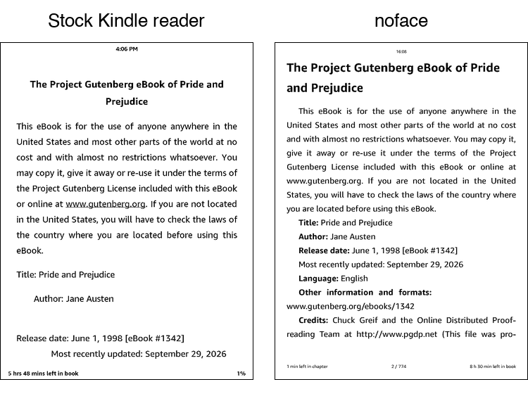

# noface

**Your Kindle, without the wait.**

noface replaces the Kindle Paperwhite's home screen and reader with one built for
speed. Pages turn the moment you tap, and everything you rely on keeps working:
your Amazon library, sync, highlights and Wi‑Fi.

<b>New page in ~60 ms with noface, ~330 ms with the stock reader.</b> 
Same Kindle, same book, measured on the device. <a href="docs/DEVELOPING.md#how-the-speed-comparison-was-measured">How</a>.

## Unique features

Things the stock Kindle doesn't do:

- **Pages in ~60 ms.** About five times faster than the stock reader, measured on
  the same Kindle.
- **Just your books.** A home screen with your library and nothing else: no store
  shelves, deals or subscription banners.
- **EPUBs that just open.** Copy them over USB and read them; no Send to Kindle.
- **Wi‑Fi off while you read.** It switches itself off a couple of minutes into a
  book and back on when you're done, so the battery lasts longer.
- **How long your charge will last.** Tap the battery for an estimate in days, from
  how you actually read.
- **Series from your own files.** Books in a series are grouped and kept in order,
  and finishing one offers the next.
- **Your highlights on the lock screen.** Put the Kindle to sleep mid-book and it
  shows one of the passages you highlighted in it, a different one each time.

## And everything you'd expect

Definitions and highlights (synced with the Kindle apps for Amazon books), search as
you type, four typefaces (plus your own, dropped in the Kindle's `fonts` folder) with
size, spacing, margins and hyphenation, pictures full screen with zoom, reading stats
with your daily minutes and streak, and series you can fix by hand.

## Get it

You'll need a **jailbroken Kindle Paperwhite (12th gen)** with KMC and KPM. That's the
only Kindle it's tested on so far.

1. Download the latest **noface-*.zip** from [Releases](../../releases/latest) and
   unzip it.
2. Plug in the Kindle. Copy the **noface** folder to its drive, and the folder
   **noface/kpm/noface** into **kmc/kpm/packages**.
3. Eject, and type `;kpm launch noface` in the Kindle's search bar.

Updating is the same copy: your settings, reading positions and stats live in a
separate **noface-data** folder that updates never touch. Dictionaries are an optional
download, explained in the release notes.

## Good to know

- noface never removes or works around DRM. Books that are protected, as most bought
  from Amazon are, open in the Kindle's own reader instead.
- Jailbreaking is your own choice, under your own agreement with Amazon: it may go
  against Amazon's terms and void your warranty. noface doesn't jailbreak anything.
- noface comes as is, with no warranty. It is an independent project, not made,
  endorsed or supported by Amazon. "Kindle" is a trademark of Amazon.com, Inc. or its
  affiliates, used here only to say which device noface runs on.

## License

Free for personal, noncommercial use under the
[PolyForm Noncommercial License 1.0.0](LICENSE.md): use it, change it and share it,
but don't sell it or build it into a commercial product. Contributions are welcome and
come under the same terms.

noface builds on [stb](https://github.com/nothings/stb), the TeX hyphenation patterns
and [Wiktionary](https://www.wiktionary.org) definitions (CC BY-SA 4.0), each under its
own license: see [THIRD_PARTY_NOTICES.md](THIRD_PARTY_NOTICES.md).
